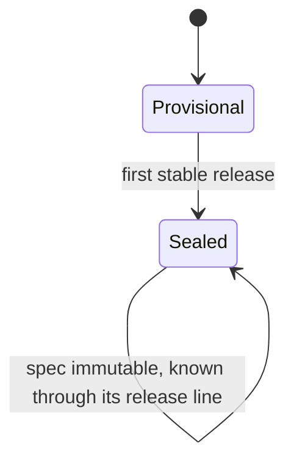

# Workflow Editions

A workflow edition is a named row of behavioural defaults: the values a participant would otherwise hardcode, such as the default episode step bound, the trial-index reset option key, and the info keys an episode's success is read from. An edition is named `YYYY.MM`, and each has one spec document in this section.

Editions answer a different question than the wire. The protocol generation (`rlmesh-realtime-v1`) and the session wire revision decide whether two builds can talk at all (see [versioning](../versioning.md)). The edition decides which defaults apply once they do.

## Declaring an Edition

An edition is a local declaration, like Rust's `edition` or Home Manager's `home.stateVersion`: you write down the edition you authored against and leave it until you deliberately move it. It is never negotiated between participants.

```python
import rlmesh


class MyEnv(rlmesh.EnvFactory):
    # What rlmesh.current_workflow_edition() printed on the build you
    # authored against. Leave it here until you deliberately move it.
    workflow_edition = "2026.10"

    def make(self): ...
```

A participant runs at its declaration, else the build's current edition (`rlmesh.current_workflow_edition()`). The declaration is in source: `EnvFactory.workflow_edition` / `Model.workflow_edition` in Python, `EnvFactory::workflow_edition` / `Policy::workflow_edition` in Rust, the factory attributes or model vtable in C. For a served env or model, `ServeOptions.workflow_edition` stands above the type's. A blank value declares nothing. Only the winner is validated, when the participant runs or serves, and every language resolves the same way. Every build of a release line, release, prerelease or source build, has the same current edition: the bare `YYYY.MM`.

`rlmesh describe` stamps the resolved edition into the image's describe label at build time, so an image always carries one, and nothing at deploy time changes it: no environment variable or flag overrides an edition, so a running image behaves as the edition it was written against.

## Applying Defaults

Whoever applies a default reads the declaring participant's edition and uses that row: the run driver uses the env's edition for episode bounds, reset options and success keys. The one refusal is an edition this build does not know, typically one from a newer release. It fails with the edition, the editions this build knows, and the remedy: upgrade the runtime to a release that knows it, or rebuild the image on a release whose edition the runtime knows. `rlmesh check-image` checks the same thing before an image runs.

## When a New Edition Is Created

Only when a default actually changes. A new feature, field or capability is not an edition, and neither is a bug fix: an implementation that deviates from its edition's spec has a bug.

## Lifecycle: Provisional, Then Sealed

An edition is **provisional** until the first stable release that ships it **seals** it: its spec document becomes immutable (enforced by checksum), and any later change to a default is a new edition. Sealed editions stay known to every later release of their line.



Before 1.0, a new minor may drop a sealed edition. `[workflow.dropped_editions]` in `rlmesh.toml` names each one with its reason, and the record stays so its spec checksum is still verified. 0.2 drops `2026.06`, the 0.1 edition, because 0.2 replaces the 0.1 gRPC protocol with realtime sessions; see [upgrading from 0.1](../upgrading.md#workflow-editions).

## Enforcement

`rlmesh.toml` records the current edition and each edition's `status` (`provisional` or `sealed`) and `spec` path; a sealed edition also records `sealed_in` and `spec_sha256`. `scripts/check_rlmesh_policy.py` checks that the `Edition` enum in `crates/rlmesh-proto` knows exactly the recorded, undropped editions and runs at the current one, verifies sealed spec checksums, pins sealed records against the last `v*` release tag, and rejects provisional editions in a stable release. Checksums use BOM-free UTF-8, LF line endings and exactly one trailing newline.

## Editions

- [2026.10](2026.10.md) (provisional; seals at 0.2.0)
- [2026.06](2026.06.md) (sealed at 0.1.0; dropped in 0.2); [post-release errata](2026.06-errata.md)
