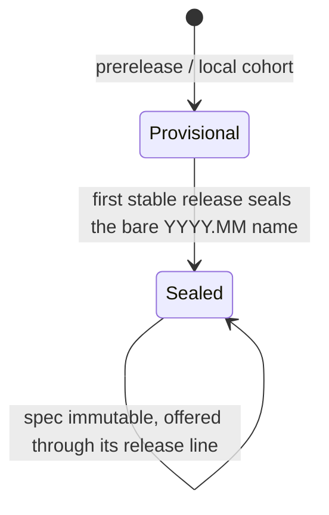

# Workflow Editions

A workflow edition is a named behavioral contract for RLMesh workflow semantics. The base edition (`YYYY.MM`) identifies one spec document in this section; prerelease and local builds offer a cohort suffix so moving builds fail closed unless both sides are from the same cohort. Exactly one edition governs a session, reconciled by the session driver.

> [!NOTE]
> The bare `2026.06` edition sealed at 0.1.0. rlmesh 0.2 runs the provisional `2026.10`, which seals at 0.2.0, and no longer offers `2026.06` (see [Support Window](#support-window)). Prerelease and local builds use exact cohort suffixes (for example `2026.10-dev.<git>`) so moving builds fail closed rather than guess they are compatible.

Editions answer a different question than the protocol generation. The protocol generation (`rlmesh-realtime-v1`) names the session wire shape. The edition names what a conforming interaction over that shape _means_: lifecycle, ordering, episode accounting, and error semantics.

## Negotiation

On a session (rlmesh 0.2) the same offers travel without a handshake. A served model declares its edition and every one it runs on `Attach` (`workflow_edition`, `workflow_editions`), and the session's roster shows them; an env publishes its offer in its env info. The driver takes the floor across the env, the model and itself and pins it on the model's `ModelResolve.workflow_edition`. A model that declares no editions in the roster is pinned to the env's edition. Nothing pins the env yet: with one edition, the floor is always the env's own.

## Declaring an Edition

An edition is a **sticky declaration**: you write down the edition you authored against, and upgrading the rlmesh package never changes how your env or model behaves. It is the same idea as NixOS's `system.stateVersion`. Declare it once, in source, and leave it there until you deliberately move it.

Paste the value `rlmesh.current_workflow_edition()` reports on the build you are authoring against: the bare base (`2026.10`), on every build of that edition. It names the contract, not a particular build of it, so it selects whichever spelling both sides offer — the sealed name on a release, the build's own cohort (`2026.06-dev.<git>`, what `rlmesh.build_info().workflow_edition` reports) on a prerelease or source build. A cohort spelling is also accepted when its ceiling admits an edition this build offers. It can select an older sealed edition both sides offer; it does not promise to reproduce an arbitrary prerelease build. Use the bare base for a durable declaration.

```python
import rlmesh


class MyEnv(rlmesh.EnvFactory):
    # What rlmesh.current_workflow_edition() printed on the build you
    # authored against. Leave it here until you deliberately move it.
    workflow_edition = "2026.10"

    def make(self): ...
```

Every participant declares independently. The highest declaration that all of them can run is the session's edition; when no such edition exists the session is refused before any episode starts, with a message naming what each tier (env, model, runtime) wants and can do.

### Precedence

Highest first. The two sticky homes are the ones that travel with your source.

| Surface                                                       | Scope           | Sticky?                               |
| ------------------------------------------------------------- | --------------- | ------------------------------------- |
| `run(workflow_edition=...)` / `session(workflow_edition=...)` | one call        | no                                    |
| `RLMESH_WORKFLOW_EDITION`                                     | one process     | no — a deployment override            |
| `ServeOptions(workflow_edition=...)` / `--workflow-edition`   | one served peer | no                                    |
| `EnvFactory.workflow_edition` / `Model.workflow_edition`      | the class       | **yes — source-resident**             |
| `[tool.rlmesh] workflow_edition` in `pyproject.toml`          | the project     | **yes — project-resident**            |
| nothing declared                                              | —               | floats to this build's newest edition |

A value this build cannot run a session at is refused where you typed it, naming the value and the editions this build offers. Accepted are the bare base of every edition the build retains (`rlmesh.current_workflow_edition()` and any older sealed edition), plus any cohort spelling that admits one of its offers. Anything else — a base no release implements, or a stale prerelease cohort that sorts below everything this build offers — raises there and then.

Declaring nothing is allowed. A participant with a home for the declaration -- an authored `EnvFactory`/`Model` subclass, or anything served -- warns once per process (`rlmesh.WorkflowEditionWarning`), naming the edition it floated to: an undeclared peer's behavior follows whatever rlmesh you happen to have installed. An ad hoc callable in a local `run`/`session` floats quietly. Set `RLMESH_WORKFLOW_EDITION` to an empty string to float deliberately: resolution stops at that rung -- no class or project declaration below it is consulted -- and the warning stays quiet. That is what this repository's own test suites do, since they exercise whatever they were built from rather than a sealed contract.

## Edition vs. Capability vs. Bug Fix

Most development never touches the edition:

- A change to the meaning of an existing, conforming interaction mints a new edition. This is rare, and breaking semantic changes batch into at most one new edition per release.
- A new addition that is ignorable or detectable, such as a new RPC, a new field, or an opt-in behavior, is a capability or a plain feature. No edition.
- An implementation that deviates from the governing spec document has a bug. Fixing it needs no edition.

## Lifecycle: Provisional, Then Sealed

An edition is **provisional** while no stable release has shipped it: prerelease builds use exact release-cohort names (`YYYY.MM-X.Y.Z-beta.N`), and local source builds use exact `dev.<git>` cohort names. This prevents accidental interoperability between moving builds that have not had stable-release scrutiny. The first stable release that ships an edition **seals** the bare `YYYY.MM` name: the spec document becomes immutable (enforced by checksum), and any later semantic change mints a new edition.



`2026.06` used provisional cohorts through the 0.1 prerelease series and sealed at v0.1.0. Its spec never changes after sealing; every 0.1.x release offers it. A new edition is minted only by a deliberate semantic redesign, never on a schedule. `2026.10` is the 0.2 redesign: it uses `2026.10-0.2.0-<prerelease>` cohorts and seals at v0.2.0.

## Support Window

Sealing freezes an edition's spec by checksum. Sealed editions are retained within a release line: every later release of the line keeps offering and accepting a sealed edition, including betas for a later edition. `rlmesh.toml` is the retained list, the crates generate their offer from it, and `mise run policy:check` fails if a sealed edition leaves it or if the list lost an edition the last release tag had sealed. The 0.1 wire remains available in the published 0.1 crates; 0.2 uses sessions only; broader API stabilization remains on the roadmap (see [compatibility](../compatibility.md)). A provisional cohort, which no stable release has sealed, may change or be dropped and interoperates only with the same cohort unless both sides advertise an older sealed edition. A prerelease or dev build never offers the official current edition (the first line of `crates/rlmesh-proto/supported_editions.txt`), so it does not meet a stable release of the edition it builds on.

Only a new major line (each 0.x minor, before 1.0) may drop one. `[workflow.dropped_editions]` in `rlmesh.toml` names each sealed edition a release stops offering, with the reason; `policy:check` exempts exactly those from the retention rule, and requires that each keeps its sealed record (so its spec checksum is still verified) and is not also offered. 0.2 uses it once: 0.2 is a major break; the managed platform keeps 2026.06 through its 0.1 stack. A 0.2 build therefore offers only `2026.10`; managed users who stay on `2026.06` keep it through the platform's 0.1 runner. Whether 0.2 should keep offering `2026.06` instead is still an open decision.

Before 1.0, then, an edition protects a participant across releases of one line, not across every future release; keeping editions across lines is the goal for 1.0.

## Enforcement

`rlmesh.toml` records the base edition, current official release cohort, supported editions, and each edition's `status` (`provisional` or `sealed`) plus `spec` path. A sealed edition also records `sealed_in` and `spec_sha256`. `scripts/check_rlmesh_policy.py` verifies sealed spec checksums, rejects provisional editions in stable releases, and checks that prerelease cohorts match the workspace SemVer. Local dev cohorts are generated at build time and are not committed to the manifest.

### Wire governance

`rlmesh-realtime-v1` is the only governed wire contract in 0.2. It is
provisional until 0.2.0 freezes it. `rlmesh.toml` records its proto tree,
baseline and freeze tag under `[protocols."rlmesh-realtime-v1"]`.
`protocol:baseline-verify` and `protocol:breaking` enforce the frozen contract;
buf lint and session byte goldens protect it while provisional.

`rlmesh-proto` retains internal data messages and edition logic for the run
driver. Its messages are not a remote protocol and carry no wire-v1 promise.

## Editions

- [2026.10](2026.10.md) (provisional; seals at 0.2.0)
- [2026.06](2026.06.md) (sealed at 0.1.0; not offered by 0.2)
